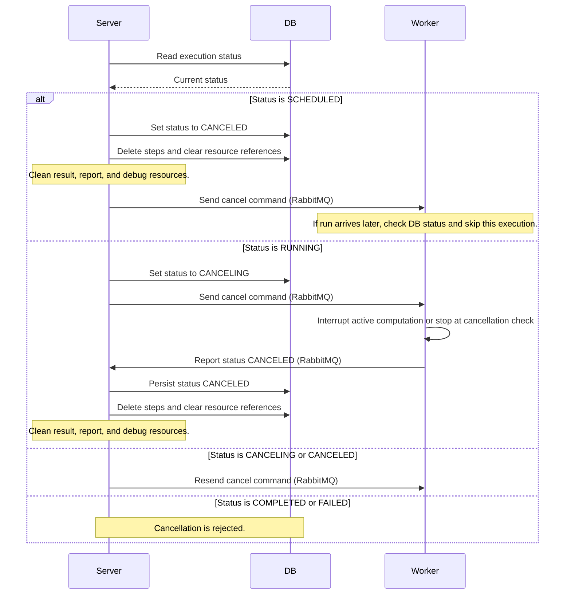

# Monitor core

`monitor-core` contains the backend services used to configure, launch, and monitor asynchronous GridSuite processes.

## Module Documentation

Read the child module documentation for service-specific details:

- [`monitor-commons`](monitor-commons/README.md): shared contracts used by the server and workers.
- [`monitor-server`](monitor-server/README.md): main REST backend and BFF for `gridmonitor-app`.
- [`monitor-worker-server`](monitor-worker-server/README.md): worker service dedicated to asynchronous computations.

## Overview

`monitor-server` manages process configurations, starts executions, stores execution and step statuses in PostgreSQL, and publishes run requests to RabbitMQ.

`monitor-worker-server` consumes those requests, executes the configured process steps, sends status updates back to the server, and stores computation results or debug artifacts when needed.

## Process cancellation

Call `POST /v1/executions/{executionId}/cancel` to request cancellation. A scheduled execution is marked `CANCELED` immediately; a running execution moves to `CANCELING` until the worker stops and reports `CANCELED`. On that final status update, the server removes execution results and report/debug resources, deletes step records, and clears resource references. The endpoint returns `200` when cancellation is requested, `204` when it is already canceled or canceling, `404` when the execution does not exist, and `409` when it has completed or failed.

## Liquibase

Please read [liquibase usage](https://github.com/powsybl/powsybl-parent/#liquibase-usage) for instructions to automatically generate changesets.
After generating a changeset, add it to Git and reference it in `monitor-server/src/main/resources/db/changelog/db.changelog-master.yaml`.
